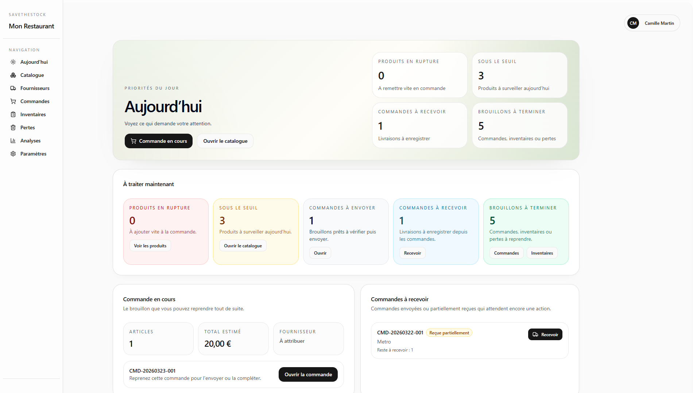
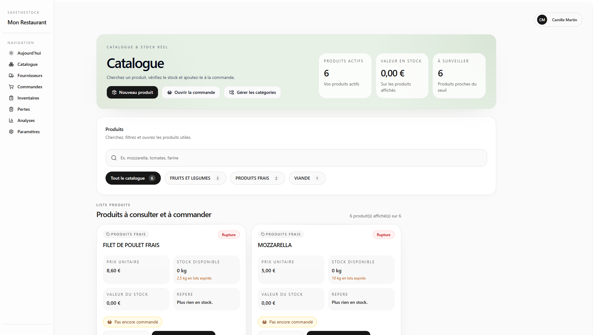
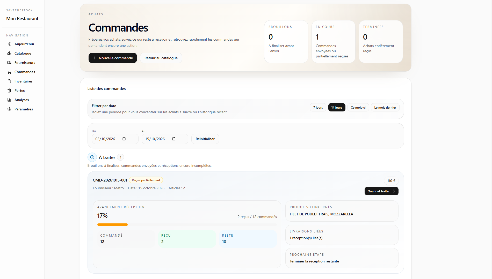
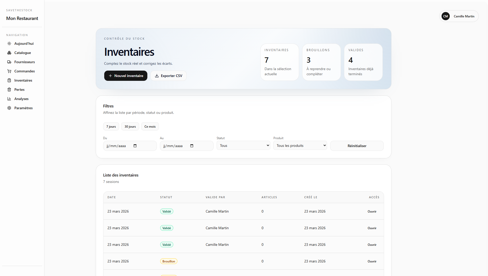
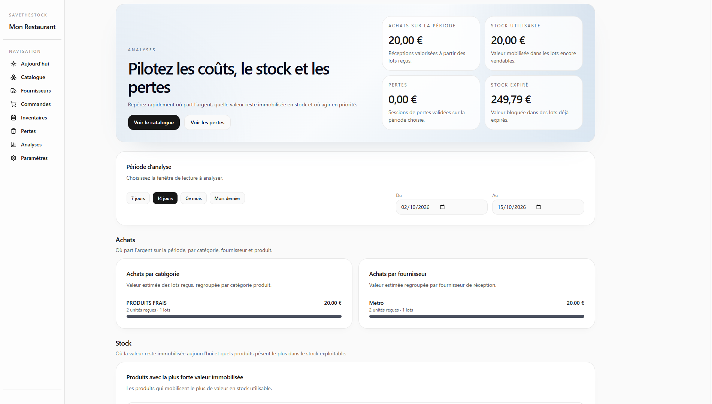
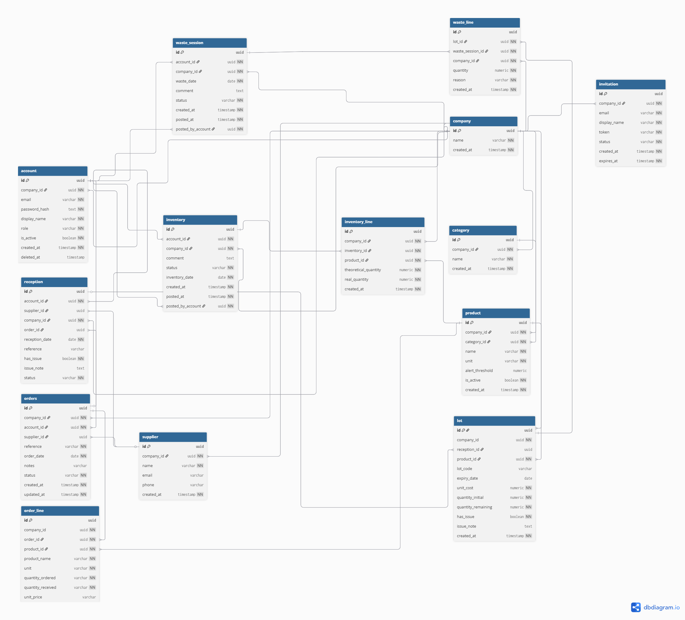
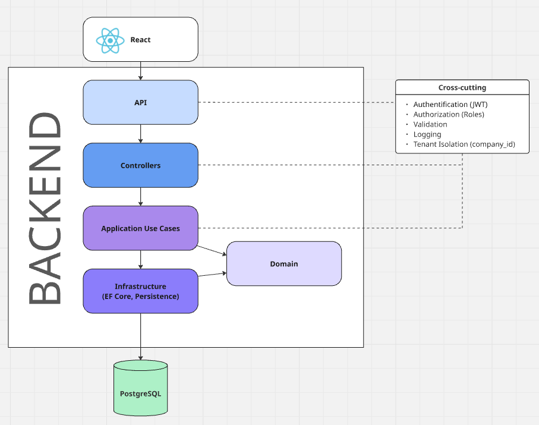
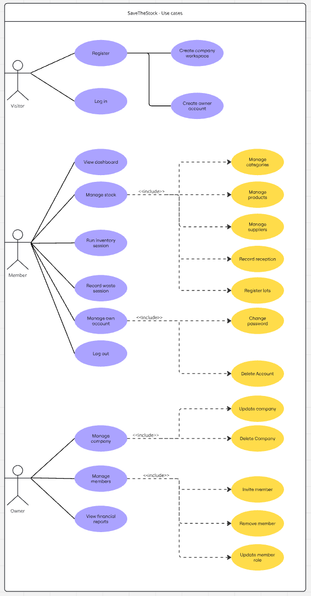

# 📦 SaveTheStock

### SaaS de gestion des stocks pour la restauration

[](https://github.com/CamFav/savethestock/actions/workflows/ci.yml)
[](https://github.com/CamFav/savethestock/actions/workflows/cd.yml)
[](https://dotnet.microsoft.com/)
[](https://react.dev/)
[](https://www.typescriptlang.org/)
[](https://www.postgresql.org/)
[](https://www.docker.com/)
[](https://github.com/CamFav/savethestock/actions)

> **SaveTheStock** est une application web SaaS destinée aux restaurants, dark kitchens et professionnels de la restauration.
>
> Elle centralise la gestion des produits, des fournisseurs, des commandes, des réceptions, des inventaires et des pertes alimentaires, au sein d'un environnement multi-entreprise sécurisé.

Le projet repose sur une **Clean Architecture**, une API REST en **ASP.NET Core .NET 10**, un frontend **React 19 / TypeScript**, une base **PostgreSQL** et une infrastructure conteneurisée avec **Docker**.

---

## 🎯 Objectifs

SaveTheStock répond à plusieurs problématiques du secteur de la restauration :

- **Centraliser** les informations de stock et les opérations quotidiennes.
- **Fiabiliser** les quantités disponibles et les mouvements de stock.
- **Simplifier** la gestion des commandes et des réceptions fournisseurs.
- **Réduire le gaspillage alimentaire** grâce au suivi des lots et des pertes.
- **Faciliter les inventaires** et l'identification des écarts.
- **Aider à la décision** grâce aux indicateurs et analyses.
- **Permettre la collaboration** entre plusieurs membres d'une même entreprise.

---

## 📸 Aperçu de l'application

### 🏠 Tableau de bord

Vue synthétique des indicateurs opérationnels et des informations utiles au suivi quotidien.



### 📦 Catalogue et stocks

Gestion des produits, catégories, fournisseurs, lots et informations de stock.



### 🛒 Commandes fournisseurs

Création, modification et suivi des commandes fournisseurs.



### 📋 Inventaires

Saisie des quantités réelles, gestion des écarts et validation des inventaires.



### 📊 Analyses

Suivi des indicateurs de gestion : valeur des stocks, pertes et écarts d'inventaire.



---

## ✨ Fonctionnalités

| Module | Fonctionnalités |
|---|---|
| **Authentification** | Inscription, connexion, gestion des comptes et JWT |
| **Multi-entreprise** | Isolation des données par entreprise (`company_id`) |
| **Gestion des membres** | Invitations, rôles `OWNER` et `MEMBER` |
| **Catalogue** | Gestion des produits et catégories |
| **Fournisseurs** | Création, consultation, modification et suppression |
| **Lots** | Gestion des quantités et des dates de péremption |
| **Commandes** | Brouillons, lignes de commande, envoi et annulation |
| **Réceptions** | Réceptions partielles ou complètes des commandes |
| **Stocks** | Consultation des quantités et valorisation |
| **Inventaires** | Saisie, ajustement et validation des inventaires |
| **Pertes** | Déclaration et suivi des pertes alimentaires |
| **Tableau de bord** | Indicateurs et synthèse des opérations |
| **Analyses** | Valeur du stock, pertes et écarts d'inventaire |

### Cycle de vie des commandes

Les commandes suivent plusieurs états métier :

```text
DRAFT
  │
  ▼
SENT
  │
  ├──► PARTIALLY_RECEIVED
  │             │
  ▼             ▼
RECEIVED ◄──────┘
```

L'état `CANCELED` permet également de représenter une commande annulée selon les règles métier.

---

## 🚀 Stack technique

### Backend

- **C# / .NET 10**
- ASP.NET Core Web API
- Entity Framework Core 10
- PostgreSQL
- Authentification et autorisation JWT
- Swagger / OpenAPI
- xUnit pour les tests backend

### Frontend

- **React 19**
- TypeScript 5
- Vite 7
- Tailwind CSS 4
- shadcn/ui et Radix UI
- Zustand — gestion d'état
- TanStack Query — gestion des données serveur
- React Router — navigation
- React Hook Form et Zod — formulaires et validation
- Recharts — visualisation des données
- Axios — communication HTTP

### DevOps et infrastructure

- Docker et Docker Compose
- GitHub Actions — CI/CD
- GitHub Container Registry (GHCR)
- PostgreSQL 16
- Git / GitHub

---

## 🏗️ Architecture

Le backend suit les principes de la **Clean Architecture**, afin de séparer les règles métier des dépendances techniques.

```text
savethestock/
│
├── backend/
│   ├── SaveTheStock.Api/
│   │   └── API HTTP, contrôleurs et configuration
│   │
│   ├── SaveTheStock.Application/
│   │   └── Cas d'utilisation et interfaces
│   │
│   ├── SaveTheStock.Domain/
│   │   └── Entités et règles métier
│   │
│   ├── SaveTheStock.Infrastructure/
│   │   └── EF Core, PostgreSQL et services techniques
│   │
│   ├── SaveTheStock.Api.Tests/
│   │   └── Tests backend
│   │
│   └── SaveTheStock.sln
│
├── frontend/
│   ├── src/
│   ├── Dockerfile
│   └── package.json
│
├── docs/
│   └── screenshots/
│       ├── dashboard-overview.png
│       ├── catalogue.png
│       ├── commandes.png
│       ├── inventory.png
│       └── analyse.png
│
├── .github/
│   └── workflows/
│       ├── ci.yml
│       └── cd.yml
│
├── compose.yaml
├── compose.production.yaml
├── .env.example
└── README.md
```

### Responsabilités des couches

| Couche | Responsabilité |
|---|---|
| **Domain** | Entités, modèles et règles métier |
| **Application** | Cas d'utilisation et orchestration métier |
| **Infrastructure** | Persistance, accès aux données et services techniques |
| **Api** | Exposition HTTP, authentification et configuration |
| **Frontend** | Interface utilisateur et communication avec l'API |

### Architecture multi-tenant

SaveTheStock permet à plusieurs entreprises d'utiliser la même application tout en conservant leurs données distinctes.

Chaque ressource métier est associée à une entreprise par un identifiant `company_id`.

Les jetons JWT transportent notamment les informations suivantes :

- `account_id` : identifiant du compte ;
- `company_id` : entreprise associée ;
- `role` : rôle de l'utilisateur.

Le backend applique des contrôles d'authentification et d'autorisation afin de limiter l'accès aux ressources de l'entreprise concernée.

---


## 📐 Conception et modélisation

La conception de SaveTheStock s'appuie sur une modélisation des données, des interactions utilisateur et de l'architecture applicative.

Les diagrammes ci-dessous présentent les principales décisions de conception du projet.

### 🗄️ Modèle physique de données (MPD)

Le modèle physique de données décrit la structure de la base PostgreSQL, les entités métier, leurs relations et les contraintes associées.

Il couvre notamment les entreprises, comptes, produits, catégories, fournisseurs, commandes, réceptions, lots, inventaires et pertes.

[](docs/diagrams/mpd.png)

### 🧩 Diagramme d'architecture applicative

Ce diagramme présente les principaux composants techniques de SaveTheStock et leurs interactions :

- Frontend React / TypeScript ;
- API REST ASP.NET Core ;
- Couches Domain, Application et Infrastructure ;
- Base PostgreSQL ;
- Infrastructure Docker et pipeline GitHub Actions.

[](docs/diagrams/architecture.png)

### 👥 Diagramme de cas d'utilisation

Le diagramme de cas d'utilisation présente les interactions entre les acteurs du système et les principales fonctionnalités.

Il permet notamment de visualiser les responsabilités des membres et des propriétaires d'entreprise.

[](docs/diagrams/use-cases.png)

### 📂 Documentation technique

Les diagrammes sont disponibles dans le dossier [`docs/diagrams/`](docs/diagrams/).

---


## 🛠️ Installation locale

### Prérequis

- Git
- Docker Engine ou Docker Desktop
- Docker Compose

L'environnement Docker permet de lancer les différents services sans installer manuellement .NET, Node.js ou PostgreSQL.

### 1. Cloner le dépôt

```bash
git clone https://github.com/CamFav/savethestock.git
cd savethestock
```

### 2. Configurer l'environnement

Copier le fichier d'exemple :

```bash
cp .env.example .env
```

Adapter les variables si nécessaire :

```dotenv
POSTGRES_DB=savethestock
POSTGRES_USER=savethestock
POSTGRES_PASSWORD=replace_with_local_password
POSTGRES_PORT=5432

JWT_SECRET=replace_with_a_random_secret_at_least_32_chars_long
DEV_SEED_ENABLED=false

FRONTEND_PORT=5173
BACKEND_PORT=8080
VITE_API_TIMEOUT_MS=15000
```

> ⚠️ Ne jamais utiliser les secrets d'exemple dans un environnement de production ni versionner le fichier `.env`.

### 3. Démarrer les services

```bash
docker compose up --build
```

Cette commande démarre :

1. PostgreSQL ;
2. l'API ASP.NET Core ;
3. le frontend React / Vite.

### 4. Accéder à l'application

| Service | Adresse |
|---|---|
| Frontend | http://localhost:5173 |
| Backend API | http://localhost:8080 |
| Health check | http://localhost:8080/health |
| Swagger (développement) | http://localhost:8080/swagger |
| PostgreSQL | `localhost:5432` |

### 5. Arrêter les services

```bash
docker compose down
```

Les données PostgreSQL sont conservées dans un volume Docker.

Pour supprimer également les volumes :

```bash
docker compose down -v
```

> ⚠️ Cette dernière commande supprime les données persistées dans les volumes du projet.

---

## 💻 Développement

### Frontend

```bash
cd frontend

npm ci
npm run dev
```

Vérification du code :

```bash
npm run lint
npm run build
```

### Backend

```bash
cd backend

dotnet restore SaveTheStock.sln
dotnet build SaveTheStock.sln
dotnet test SaveTheStock.sln
```

L'environnement Docker de développement utilise :

- **Vite** avec rechargement automatique pour le frontend ;
- **dotnet watch** pour le backend ;
- un volume Docker persistant pour PostgreSQL.

---

## 🧪 Tests et qualité

Le projet dispose d'une intégration continue automatisée avec GitHub Actions.

| Composant | Vérifications |
|---|---|
| **Frontend** | Installation des dépendances, ESLint, compilation TypeScript et Vite |
| **Backend** | Restauration, compilation .NET et tests automatisés |
| **Docker** | Construction des images frontend et backend |

Les tests backend sont regroupés dans le projet `SaveTheStock.Api.Tests` et exécutés automatiquement dans la CI.

[](https://github.com/CamFav/savethestock/actions/workflows/ci.yml)

---

## 🔌 API REST

L'API ASP.NET Core expose les fonctionnalités métier nécessaires à l'application.

| Domaine | Opérations principales |
|---|---|
| Authentification | Inscription et connexion |
| Comptes | Profil, membres et invitations |
| Entreprises | Gestion des espaces d'entreprise |
| Catalogue | Produits et catégories |
| Fournisseurs | Gestion des fournisseurs |
| Lots | Gestion et suivi des lots |
| Commandes | Création, modification, envoi et annulation |
| Réceptions | Enregistrement des quantités reçues |
| Inventaires | Saisie et validation |
| Pertes | Déclaration et suivi |
| Dashboard | Indicateurs opérationnels |

L'API utilise des échanges JSON et des mécanismes d'authentification adaptés aux ressources protégées.

La documentation **Swagger / OpenAPI** est disponible en environnement de développement.

---

## 🛡️ Sécurité

Plusieurs mécanismes sont intégrés au backend :

- **Authentification JWT** : validation de la signature, de l'émetteur, de l'audience et de l'expiration.
- **Contrôle d'accès par rôle** : distinction entre propriétaires et membres.
- **Isolation multi-tenant** : accès aux données limité à l'entreprise associée.
- **Validation des comptes actifs** : contrôle de l'état du compte lors de la validation des jetons.
- **Validation des requêtes** : réponses structurées pour les erreurs de validation.
- **CORS** : origines autorisées configurables.
- **Secrets** : configuration par variables d'environnement.

Ces protections participent à la sécurité applicative sans remplacer un audit de sécurité complet.

---

## ⚙️ CI/CD — GitHub Actions

Le projet utilise deux workflows complémentaires.

### 🔄 CI — Intégration continue

**Workflow :** `.github/workflows/ci.yml`

Déclenché sur les pushs et Pull Requests.

Le pipeline exécute :

1. Installation des dépendances frontend.
2. Analyse statique avec ESLint.
3. Compilation React / TypeScript.
4. Restauration des dépendances .NET.
5. Compilation du backend.
6. Exécution des tests backend.
7. Construction des images Docker.

[](https://github.com/CamFav/savethestock/actions/workflows/ci.yml)

### 📦 CD — Publication des images Docker

**Workflow :** `.github/workflows/cd.yml`

Le workflow de livraison continue est destiné à publier les images sur **GitHub Container Registry (GHCR)** après une CI réussie sur `main`.

Images :

```text
ghcr.io/camfav/savethestock-frontend
ghcr.io/camfav/savethestock-backend
```

Tags prévus :

- `latest` : dernière image publiée ;
- `main` : version issue de la branche principale ;
- `sha-xxxxxxx` : version associée à un commit précis.

[](https://github.com/CamFav/savethestock/actions/workflows/cd.yml)

> **Note :** la publication des images Docker est distincte d'un déploiement sur un serveur. Le déploiement SSH automatique a été suspendu.

---

## 🐳 Déploiement avec Docker Compose

Le fichier `compose.production.yaml` permet de lancer l'application à partir d'images Docker préconstruites.

### Configuration

Préparer les variables d'environnement nécessaires :

```dotenv
FRONTEND_IMAGE=ghcr.io/camfav/savethestock-frontend:latest
BACKEND_IMAGE=ghcr.io/camfav/savethestock-backend:latest

POSTGRES_DB=savethestock
POSTGRES_USER=savethestock
POSTGRES_PASSWORD=replace_with_strong_password

JWT_SECRET=replace_with_a_secure_random_secret_at_least_32_chars
APP_ORIGIN=https://your-domain.example
FRONTEND_PORT=80
```

### Lancement

Après configuration de l'environnement et de l'accès au registre :

```bash
docker compose -f compose.production.yaml pull
docker compose -f compose.production.yaml up -d
```

Le fichier Compose définit trois services :

- **PostgreSQL 16** : stockage des données ;
- **Backend ASP.NET Core** : API applicative ;
- **Frontend** : interface web servie depuis l'image de production.

> Le déploiement public nécessite un hébergement, une configuration HTTPS et une gestion appropriée des secrets. Aucune instance publique n'est annoncée ici.

---

## 🧭 Perspectives d'évolution

Plusieurs améliorations peuvent prolonger le projet :

- [ ] Renforcer la couverture des tests automatisés.
- [ ] Ajouter des tests end-to-end sur les parcours métier.
- [ ] Améliorer l'observabilité et le suivi des erreurs.
- [ ] Déployer l'application sur une infrastructure cloud.
- [ ] Ajouter des alertes de stock faible et de péremption.
- [ ] Développer les analyses et les prévisions de consommation.

Ces éléments constituent des pistes d'évolution et ne sont pas présentés comme des fonctionnalités déjà livrées.

---

## 👨‍💻 Auteur

**Camille Favriel** - Développeur full-stack

SaveTheStock est un projet conçu autour d'un besoin métier concret du secteur de la restauration.

Il illustre notamment :

- La conception d'une application SaaS multi-tenant.
- La modélisation de données métier.
- Le développement d'une API REST en C# / ASP.NET Core.
- La création d'une interface React / TypeScript.
- L'application des principes de la Clean Architecture.
- La conteneurisation et l'automatisation avec Docker et GitHub Actions.

**GitHub :** [CamFav](https://github.com/CamFav)

---

© 2026 — **SaveTheStock** · Camille Favriel

